# M3NVE-residual-v1：有界残差对照

本轮为 **NVE-inspired 有界残差匹配**，不是完整 IDEAL 复现。无 IDE 训练、无异常参考 mask；NVE 来自原论文。

完成60个冻结数据配置×A/B/C=180臂配置；PatchCore仅复用历史20配置原始分数。独立审计覆盖60360逐图行、181080三臂分数，路径、有限性、平均秩AUROC和配对汇总全部通过。
A对历史全60配置最坏逐路径差=7.92006683e-08，固定容差1e-4；人工向量、批量/单图、mapper及骨干参数/BN buffers不变检查通过。

## 主结果（AUROC，0–1）

|资产 / 支持预算|A|B|C|PatchCore|B−A|C−B|C−A|
|---|---:|---:|---:|---:|---:|---:|---:|
|glass-insulator/missing-cap_g1|0.674783|0.643285|0.640749|0.790120|-0.031498|-0.002536|-0.034034|
|glass-insulator/missing-cap_g2|0.789238|0.710976|0.755162|0.826500|-0.078262|0.044186|-0.034076|
|yoke-suspension/rust_g1|0.557286|0.588957|0.591656|0.688717|0.031671|0.002699|0.034370|
|yoke-suspension/rust_g2|0.650818|0.642184|0.639499|0.834854|-0.008633|-0.002685|-0.011319|

每项先对同参照组3支持种子取均值，再对5参照组取均值。PatchCore不依赖故障种子，重复对应仅用于配对。

## 稳定性与逐配置配对

|单元|比较|五组均值|组间std(ddof=0)|组均值范围|正收益组/5|负收益原配置/15|
|---|---|---:|---:|---|---:|---:|
|glass-insulator/missing-cap_g1|C-B|-0.002536|0.006237|[-0.011340, 0.004602]|2/5|9/15|
|glass-insulator/missing-cap_g1|B-A|-0.031498|0.028348|[-0.071293, 0.016285]|1/5|10/15|
|glass-insulator/missing-cap_g1|C-A|-0.034034|0.027285|[-0.076764, 0.004944]|1/5|14/15|
|glass-insulator/missing-cap_g1|A-PatchCore|-0.115337|0.211951|[-0.535482, 0.020656]|2/5|9/15|
|glass-insulator/missing-cap_g1|B-PatchCore|-0.146835|0.190162|[-0.519198, -0.008851]|0/5|13/15|
|glass-insulator/missing-cap_g1|C-PatchCore|-0.149371|0.195399|[-0.530538, -0.004249]|0/5|12/15|
|glass-insulator/missing-cap_g2|C-B|0.044186|0.032587|[0.013237, 0.107199]|5/5|3/15|
|glass-insulator/missing-cap_g2|B-A|-0.078262|0.019985|[-0.105989, -0.050276]|0/5|14/15|
|glass-insulator/missing-cap_g2|C-A|-0.034076|0.032140|[-0.067478, 0.021288]|1/5|10/15|
|glass-insulator/missing-cap_g2|A-PatchCore|-0.037263|0.016465|[-0.063510, -0.014001]|0/5|14/15|
|glass-insulator/missing-cap_g2|B-PatchCore|-0.115525|0.022495|[-0.149420, -0.095028]|0/5|15/15|
|glass-insulator/missing-cap_g2|C-PatchCore|-0.071339|0.018371|[-0.096808, -0.042221]|0/5|15/15|
|yoke-suspension/rust_g1|C-B|0.002699|0.020561|[-0.024377, 0.034360]|2/5|8/15|
|yoke-suspension/rust_g1|B-A|0.031671|0.044821|[-0.015691, 0.102354]|3/5|2/15|
|yoke-suspension/rust_g1|C-A|0.034370|0.048904|[-0.026176, 0.117841]|4/5|3/15|
|yoke-suspension/rust_g1|A-PatchCore|-0.131431|0.124811|[-0.322813, 0.041027]|1/5|11/15|
|yoke-suspension/rust_g1|B-PatchCore|-0.099760|0.100301|[-0.257485, 0.049192]|1/5|9/15|
|yoke-suspension/rust_g1|C-PatchCore|-0.097061|0.101345|[-0.269121, 0.048849]|1/5|10/15|
|yoke-suspension/rust_g2|C-B|-0.002685|0.041030|[-0.061959, 0.053012]|3/5|7/15|
|yoke-suspension/rust_g2|B-A|-0.008633|0.076121|[-0.063711, 0.137767]|1/5|8/15|
|yoke-suspension/rust_g2|C-A|-0.011319|0.045711|[-0.052190, 0.075808]|1/5|9/15|
|yoke-suspension/rust_g2|A-PatchCore|-0.184037|0.095342|[-0.313758, -0.059923]|0/5|15/15|
|yoke-suspension/rust_g2|B-PatchCore|-0.192670|0.057216|[-0.270612, -0.109429]|0/5|15/15|
|yoke-suspension/rust_g2|C-PatchCore|-0.195355|0.082091|[-0.306054, -0.088084]|0/5|15/15|

逐种子×参照组全部成绩和配对差见 [paired_configs.csv](paired_configs.csv)；全部组均值见 [nve_eval.json](nve_eval.json)。以下保留每个原始配置，避免将组均值正收益解释为所有种子均正。

|配置|A|B|C|PC|C−B|B−A|C−A|
|---|---:|---:|---:|---:|---:|---:|---:|
|glass-insulator__missing-cap_g1_k1_seed0_ref3001|0.752887|0.674941|0.679909|0.792562|0.004968|-0.077946|-0.072978|
|glass-insulator__missing-cap_g1_k1_seed1_ref3001|0.778271|0.712477|0.696809|0.792562|-0.015668|-0.065794|-0.081462|
|glass-insulator__missing-cap_g1_k1_seed2_ref3001|0.776371|0.706232|0.700519|0.792562|-0.005713|-0.070139|-0.075852|
|glass-insulator__missing-cap_g1_k1_seed0_ref3002|0.176204|0.179409|0.174363|0.717869|-0.005046|0.003205|-0.001841|
|glass-insulator__missing-cap_g1_k1_seed1_ref3002|0.183651|0.212971|0.200462|0.717869|-0.012509|0.029319|0.016810|
|glass-insulator__missing-cap_g1_k1_seed2_ref3002|0.187305|0.203635|0.187169|0.717869|-0.016466|0.016329|-0.000137|
|glass-insulator__missing-cap_g1_k1_seed0_ref3003|0.823484|0.824173|0.818897|0.807517|-0.005276|0.000689|-0.004587|
|glass-insulator__missing-cap_g1_k1_seed1_ref3003|0.828778|0.766954|0.776455|0.807517|0.009501|-0.061824|-0.052324|
|glass-insulator__missing-cap_g1_k1_seed2_ref3003|0.822276|0.794890|0.804471|0.807517|0.009582|-0.027386|-0.017805|
|glass-insulator__missing-cap_g1_k1_seed0_ref3004|0.772229|0.737841|0.739556|0.828463|0.001715|-0.034388|-0.032672|
|glass-insulator__missing-cap_g1_k1_seed1_ref3004|0.766795|0.726676|0.712141|0.828463|-0.014536|-0.040119|-0.054654|
|glass-insulator__missing-cap_g1_k1_seed2_ref3004|0.778962|0.723066|0.720661|0.828463|-0.002404|-0.055897|-0.058301|
|glass-insulator__missing-cap_g1_k1_seed0_ref3005|0.823484|0.824173|0.818897|0.804190|-0.005276|0.000689|-0.004587|
|glass-insulator__missing-cap_g1_k1_seed1_ref3005|0.828778|0.766954|0.776455|0.804190|0.009501|-0.061824|-0.052324|
|glass-insulator__missing-cap_g1_k1_seed2_ref3005|0.822276|0.794890|0.804471|0.804190|0.009582|-0.027386|-0.017805|
|yoke-suspension__rust_g1_k1_seed0_ref3001|0.398261|0.447870|0.417388|0.711068|-0.030482|0.049609|0.019127|
|yoke-suspension__rust_g1_k1_seed1_ref3001|0.619879|0.512430|0.628997|0.711068|0.116567|-0.107450|0.009117|
|yoke-suspension__rust_g1_k1_seed2_ref3001|0.758521|0.769290|0.786287|0.711068|0.016997|0.010769|0.027765|
|yoke-suspension__rust_g1_k1_seed0_ref3002|0.334280|0.378795|0.379805|0.661739|0.001010|0.044515|0.045524|
|yoke-suspension__rust_g1_k1_seed1_ref3002|0.423316|0.512599|0.574169|0.661739|0.061570|0.089283|0.150853|
|yoke-suspension__rust_g1_k1_seed2_ref3002|0.616925|0.790189|0.774072|0.661739|-0.016117|0.173264|0.157147|
|yoke-suspension__rust_g1_k1_seed0_ref3003|0.689290|0.693023|0.687094|0.695844|-0.005928|0.003733|-0.002195|
|yoke-suspension__rust_g1_k1_seed1_ref3003|0.743342|0.744775|0.754313|0.695844|0.009537|0.001433|0.010971|
|yoke-suspension__rust_g1_k1_seed2_ref3003|0.777980|0.797309|0.792671|0.695844|-0.004638|0.019329|0.014691|
|yoke-suspension__rust_g1_k1_seed0_ref3004|0.356430|0.365192|0.358769|0.722632|-0.006423|0.008762|0.002339|
|yoke-suspension__rust_g1_k1_seed1_ref3004|0.403902|0.416326|0.425427|0.722632|0.009101|0.012423|0.021524|
|yoke-suspension__rust_g1_k1_seed2_ref3004|0.439124|0.613922|0.576339|0.722632|-0.037583|0.174798|0.137215|
|yoke-suspension__rust_g1_k1_seed0_ref3005|0.423440|0.370889|0.305554|0.652300|-0.065336|-0.052550|-0.117886|
|yoke-suspension__rust_g1_k1_seed1_ref3005|0.638866|0.658684|0.631860|0.652300|-0.026824|0.019818|-0.007007|
|yoke-suspension__rust_g1_k1_seed2_ref3005|0.735726|0.763062|0.782091|0.652300|0.019029|0.027336|0.046365|
|glass-insulator__missing-cap_g2_k5_seed0_ref3001|0.787201|0.707313|0.729203|0.816182|0.021889|-0.079888|-0.057999|
|glass-insulator__missing-cap_g2_k5_seed1_ref3001|0.760323|0.687699|0.768414|0.816182|0.080715|-0.072624|0.008091|
|glass-insulator__missing-cap_g2_k5_seed2_ref3001|0.766763|0.768447|0.760729|0.816182|-0.007718|0.001684|-0.006034|
|glass-insulator__missing-cap_g2_k5_seed0_ref3002|0.771413|0.599382|0.785319|0.829390|0.185938|-0.172031|0.013906|
|glass-insulator__missing-cap_g2_k5_seed1_ref3002|0.797160|0.698009|0.700084|0.829390|0.002075|-0.099152|-0.097077|
|glass-insulator__missing-cap_g2_k5_seed2_ref3002|0.831609|0.784826|0.712343|0.829390|-0.072482|-0.046783|-0.119265|
|glass-insulator__missing-cap_g2_k5_seed0_ref3003|0.815557|0.745155|0.749782|0.851767|0.004627|-0.070403|-0.065776|
|glass-insulator__missing-cap_g2_k5_seed1_ref3003|0.802235|0.709784|0.721946|0.851767|0.012162|-0.092451|-0.080289|
|glass-insulator__missing-cap_g2_k5_seed2_ref3003|0.833348|0.812706|0.835628|0.851767|0.022922|-0.020641|0.002281|
|glass-insulator__missing-cap_g2_k5_seed0_ref3004|0.789240|0.681784|0.734672|0.810687|0.052888|-0.107455|-0.054567|
|glass-insulator__missing-cap_g2_k5_seed1_ref3004|0.799694|0.783918|0.761773|0.810687|-0.022145|-0.015776|-0.037921|
|glass-insulator__missing-cap_g2_k5_seed2_ref3004|0.801123|0.660440|0.720769|0.810687|0.060329|-0.140684|-0.080355|
|glass-insulator__missing-cap_g2_k5_seed0_ref3005|0.772820|0.697606|0.747513|0.824477|0.049908|-0.075214|-0.025306|
|glass-insulator__missing-cap_g2_k5_seed1_ref3005|0.720532|0.603660|0.803298|0.824477|0.199638|-0.116872|0.082766|
|glass-insulator__missing-cap_g2_k5_seed2_ref3005|0.789549|0.723905|0.795955|0.824477|0.072050|-0.065644|0.006406|
|yoke-suspension__rust_g2_k5_seed0_ref3001|0.456420|0.525959|0.474244|0.797112|-0.051715|0.069539|0.017824|
|yoke-suspension__rust_g2_k5_seed1_ref3001|0.508698|0.708644|0.604902|0.797112|-0.103742|0.199946|0.096203|
|yoke-suspension__rust_g2_k5_seed2_ref3001|0.484942|0.628759|0.598339|0.797112|-0.030420|0.143817|0.113397|
|yoke-suspension__rust_g2_k5_seed0_ref3002|0.795241|0.726153|0.786705|0.805566|0.060553|-0.069088|-0.008536|
|yoke-suspension__rust_g2_k5_seed1_ref3002|0.707431|0.600108|0.673817|0.805566|0.073708|-0.107322|-0.033614|
|yoke-suspension__rust_g2_k5_seed2_ref3002|0.734258|0.762149|0.691925|0.805566|-0.070224|0.027892|-0.042332|
|yoke-suspension__rust_g2_k5_seed0_ref3003|0.765559|0.611742|0.742393|0.888169|0.130651|-0.153817|-0.023166|
|yoke-suspension__rust_g2_k5_seed1_ref3003|0.802678|0.762868|0.787681|0.888169|0.024814|-0.039810|-0.014997|
|yoke-suspension__rust_g2_k5_seed2_ref3003|0.789573|0.792068|0.795641|0.888169|0.003573|0.002495|0.006068|
|yoke-suspension__rust_g2_k5_seed0_ref3004|0.666515|0.745715|0.512542|0.826386|-0.233173|0.079200|-0.153973|
|yoke-suspension__rust_g2_k5_seed1_ref3004|0.551769|0.498475|0.525661|0.826386|0.027186|-0.053295|-0.026108|
|yoke-suspension__rust_g2_k5_seed2_ref3004|0.466773|0.423132|0.522793|0.826386|0.099661|-0.043641|0.056020|
|yoke-suspension__rust_g2_k5_seed0_ref3005|0.657681|0.509349|0.541410|0.857037|0.032061|-0.148332|-0.116271|
|yoke-suspension__rust_g2_k5_seed1_ref3005|0.762400|0.767546|0.765383|0.857037|-0.002163|0.005146|0.002983|
|yoke-suspension__rust_g2_k5_seed2_ref3005|0.612325|0.570095|0.569044|0.857037|-0.001051|-0.042231|-0.043281|

## 六项裁决

glass-insulator/missing-cap_g1：B/C均值未提供总体改善，保留负结果；这不能否定论文在其他特征/监督条件下的结果。C−B=-0.002536（2/5正组，9/15负配置），B−A=-0.031498，C−A=-0.034034。

glass-insulator/missing-cap_g2：C>B但整体仍不优于A：降噪有局部价值，整体改造尚不成立。C−B=+0.044186（5/5正组，3/15负配置），B−A=-0.078262，C−A=-0.034076。

yoke-suspension/rust_g1：C>B且C>A，均值上值得继续，但仍须结合参照组和原配置负收益判断稳定性。C−B=+0.002699（2/5正组，8/15负配置），B−A=+0.031671，C−A=+0.034370。

yoke-suspension/rust_g2：B/C均值未提供总体改善，保留负结果；这不能否定论文在其他特征/监督条件下的结果。C−B=-0.002685（3/5正组，7/15负配置），B−A=-0.008633，C−A=-0.011319。

1. C是否稳定优于B：不满足跨资产、跨预算、全部参照组与种子的稳定增量要求。以上逐单元结果给出边界；不作独立显著性声明。

2. 改善来源以同配置恒等分解 C−A=(B−A)+(C−B)判断。B−A是“残差匹配评分改造”的整体作用，包含与dN组合方式的变化，不应解释为单独向量相减的因果效应。

3. 资产与预算一致性：分别看上表方向和原始配置负收益；1N1A与5N5A查询集合不同，不能将差异解释为纯shot效应。各臂参照组范围如下。

|单元|A组均值范围|B组均值范围|C组均值范围|
|---|---|---|---|
|glass-insulator/missing-cap_g1|[0.1824,0.8248]|[0.1987,0.7953]|[0.1873,0.7999]|
|glass-insulator/missing-cap_g2|[0.7610,0.8170]|[0.6751,0.7559]|[0.7326,0.7823]|
|yoke-suspension/rust_g1|[0.3998,0.7369]|[0.4651,0.7450]|[0.4535,0.7447]|
|yoke-suspension/rust_g2|[0.4834,0.7859]|[0.5558,0.7222]|[0.5203,0.7752]|

4. 与PatchCore的差距（正差表示PatchCore更高；缩小量负数表示扩大）：

|单元|PC−A|PC−B|PC−C|C相对A缩小量|
|---|---:|---:|---:|---:|
|glass-insulator/missing-cap_g1|0.115337|0.146835|0.149371|-0.034034|
|glass-insulator/missing-cap_g2|0.037263|0.115525|0.071339|-0.034076|
|yoke-suspension/rust_g1|0.131431|0.099760|0.097061|0.034370|
|yoke-suspension/rust_g2|0.184037|0.192670|0.195355|-0.011319|

1N1A比较原1N PatchCore；5N5A比较原10N PatchCore，监督组成不同。未重建PatchCore库、未新增PatchCore实验。

5. 机制检查：下表按图像标签统计所属全部patch。两类图的范数都降低只能说明两类图内表示都被压缩；余弦匹配对缩放不敏感，且没有像素mask，不能据此声称故障像素证据被删或测得故障像素保留率。结合图像分数C−B与AUROC变化评估可能的共同削弱。

|单元|图像标签|raw范数均值|clean范数均值|clean/raw均值(非零)|零残差/总patch|零秩/总patch|
|---|---|---:|---:|---:|---|---|
|glass-insulator/missing-cap_g1|normal|0.254305|0.210599|0.824765|0/4000000|0/4000000|
|glass-insulator/missing-cap_g1|defect|0.248762|0.202524|0.813831|0/5736000|0/5736000|
|glass-insulator/missing-cap_g2|normal|0.263471|0.207925|0.790488|0/4000000|0/4000000|
|glass-insulator/missing-cap_g2|defect|0.263600|0.206502|0.784811|0/5640000|0/5640000|
|yoke-suspension/rust_g1|normal|0.253248|0.207173|0.817754|0/4000000|0/4000000|
|yoke-suspension/rust_g1|defect|0.250585|0.204611|0.816579|0/2456000|0/2456000|
|yoke-suspension/rust_g2|normal|0.270186|0.215875|0.800435|0/4000000|0/4000000|
|yoke-suspension/rust_g2|defect|0.270317|0.215284|0.797984|0/2360000|0/2360000|

每配置的范数分位数、std、r_eff分布、故障库统计、正常/故障图像分数变化见 [MECHANISMS.json](MECHANISMS.json)。查询PCA统计跨种子去重（20个正常库配置）；跨参照和预算有重复图像，不当作独立patch样本。

6. 资源成本：

准备/复现/探针 138.71s，全量缓存评分 13234.18s，合计 13372.89s；报告另用 15.92s。这是本轮执行阶段墙钟，不是CUDA kernel计时或完整推理速度。

峰值allocated显存 0.337 GiB；映射特征payload 2,204,467,200 bytes；N/F库payload 10,485,760 bytes；新增raw+clean残差库 15,728,640 bytes；全部本轮缓存 2,764,020,772 bytes。临时查询残差/投影按batch保留，跨3种子共享；另存范数诊断缓存。

图像batch=32，局部SVD块=2048。查询和故障支持复用历史P3缓存；正常参照39张缺失缓存，各按历史单图提取一次。未进行部署测速，不引用此前加速比。

## 冻结、局限与复现

本轮torch=2.8.0+cu128，CUDA=12.8；历史torch=2.8.0+cu128。版本差异已披露，未放宽复现容差。FP32薄SVD gesvdj；k12/r4/alpha.8/eps1e-8/rank_tol1e-6，未搜索参数。

详见 [METHOD_SPEC.md](METHOD_SPEC.md)、[FROZEN_INPUTS.json](FROZEN_INPUTS.json)、[BANK_MANIFEST.json](BANK_MANIFEST.json)、[CACHE_MANIFEST.json](CACHE_MANIFEST.json)、[INDEPENDENT_AUDIT.json](INDEPENDENT_AUDIT.json)。冻结输入包括全部源图、权重、名单、代码、历史分数、划分SHA256。骨干与mapper参数/BN状态前后全SHA256一致。

k是历史裁剪支持预算，不代表独立源帧数。源身份未知不记零重叠。没有查询标签驱动阈值或调参；只做探索性图像级AUROC，未验证校准召回、误报率或完整H1。不同参照组重叠、查询共享，不独立。

## 固定样本可视化

按冻结路径顺序每资产预算前2正常和前2故障图，seed0/ref3001；未按提升挑选，无另选失败案例。A/B/C固定[-1,1]，范数固定[0,2]；无逐图min-max。

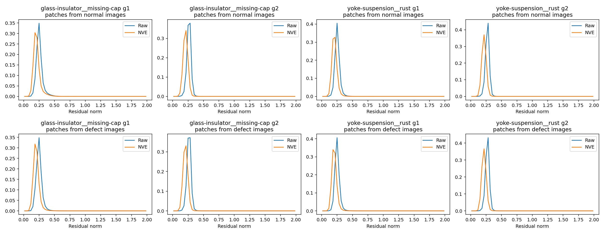

glass-insulator__missing-cap_g1_defect_0：`/root/autodl-tmp/data/insplad/defect_supervised/glass-insulator/train/missing-cap/Fotos 01-12-2020_DJI_0014_cadeia_isolador_vidro_338.jpg`

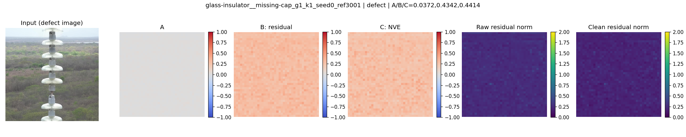

glass-insulator__missing-cap_g1_defect_1：`/root/autodl-tmp/data/insplad/defect_supervised/glass-insulator/train/missing-cap/Fotos 01-12-2020_DJI_0014_cadeia_isolador_vidro_338_0.jpg`

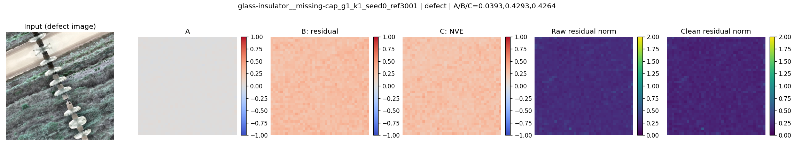

glass-insulator__missing-cap_g1_normal_0：`/root/autodl-tmp/data/insplad/defect_supervised/glass-insulator/train/good/Fotos 01-12-2020_DJI_0016_cadeia_isolador_vidro_340.jpg`

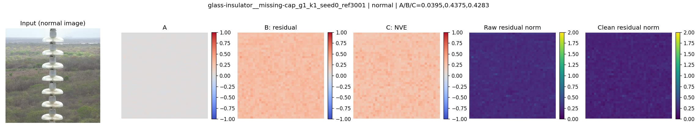

glass-insulator__missing-cap_g1_normal_1：`/root/autodl-tmp/data/insplad/defect_supervised/glass-insulator/train/good/Fotos 01-12-2020_DJI_0018_cadeia_isolador_vidro_342.jpg`

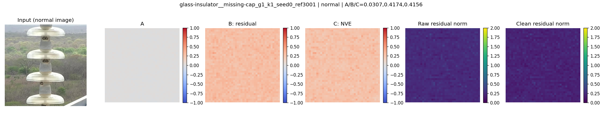

yoke-suspension__rust_g1_defect_0：`/root/autodl-tmp/data/insplad/defect_supervised/yoke-suspension/train/rust/01-06-2021_DJI_0183_55.jpg`

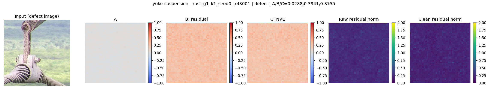

yoke-suspension__rust_g1_defect_1：`/root/autodl-tmp/data/insplad/defect_supervised/yoke-suspension/train/rust/01-06-2021_DJI_0183_55_0.jpg`

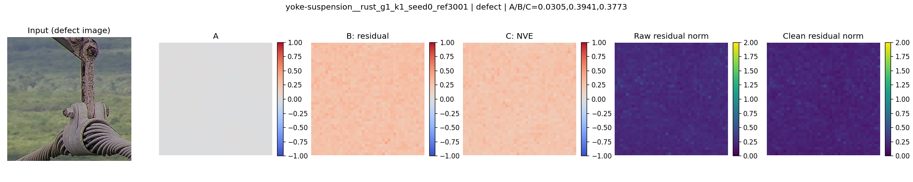

yoke-suspension__rust_g1_normal_0：`/root/autodl-tmp/data/insplad/defect_supervised/yoke-suspension/train/good/Fotos 01-12-2020_DJI_0293_amarra_balancim_222.jpg`

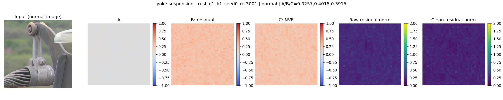

yoke-suspension__rust_g1_normal_1：`/root/autodl-tmp/data/insplad/defect_supervised/yoke-suspension/train/good/Fotos 02-12-2020_DJI_0031_amarra_balancim_650.jpg`

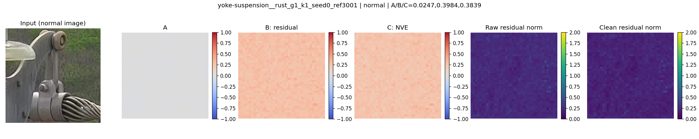

glass-insulator__missing-cap_g2_defect_0：`/root/autodl-tmp/data/insplad/defect_supervised/glass-insulator/train/missing-cap/Fotos 01-12-2020_DJI_0014_cadeia_isolador_vidro_338.jpg`

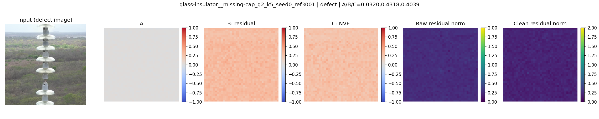

glass-insulator__missing-cap_g2_defect_1：`/root/autodl-tmp/data/insplad/defect_supervised/glass-insulator/train/missing-cap/Fotos 01-12-2020_DJI_0014_cadeia_isolador_vidro_338_0.jpg`

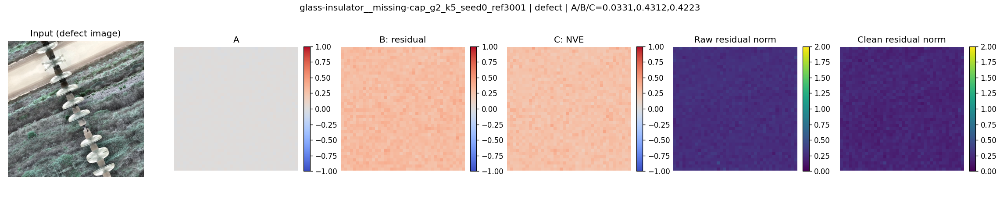

glass-insulator__missing-cap_g2_normal_0：`/root/autodl-tmp/data/insplad/defect_supervised/glass-insulator/train/good/Fotos 01-12-2020_DJI_0016_cadeia_isolador_vidro_340.jpg`


glass-insulator__missing-cap_g2_normal_1：`/root/autodl-tmp/data/insplad/defect_supervised/glass-insulator/train/good/Fotos 01-12-2020_DJI_0028_cadeia_isolador_vidro_347.jpg`

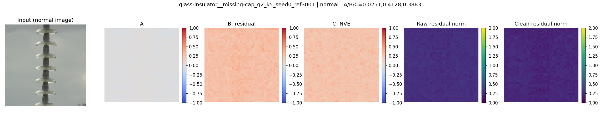

yoke-suspension__rust_g2_defect_0：`/root/autodl-tmp/data/insplad/defect_supervised/yoke-suspension/train/rust/01-06-2021_DJI_0183_55.jpg`

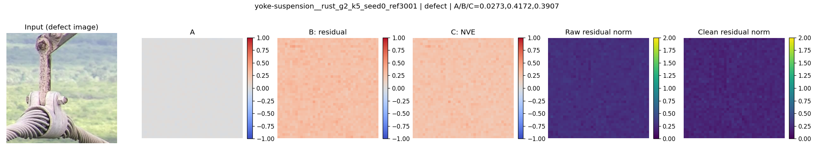

yoke-suspension__rust_g2_defect_1：`/root/autodl-tmp/data/insplad/defect_supervised/yoke-suspension/train/rust/01-06-2021_DJI_0183_55_0.jpg`


yoke-suspension__rust_g2_normal_0：`/root/autodl-tmp/data/insplad/defect_supervised/yoke-suspension/train/good/Fotos 01-12-2020_DJI_0296_amarra_balancim_231.jpg`

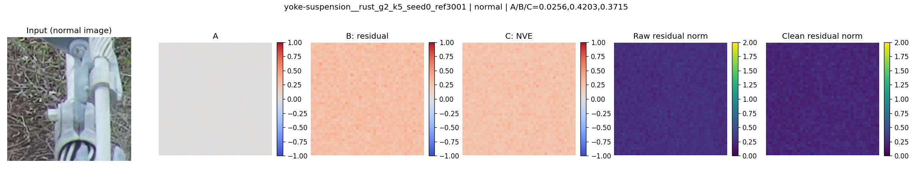

yoke-suspension__rust_g2_normal_1：`/root/autodl-tmp/data/insplad/defect_supervised/yoke-suspension/train/good/Fotos 01-12-2020_DJI_0401_amarra_balancim_161.jpg`

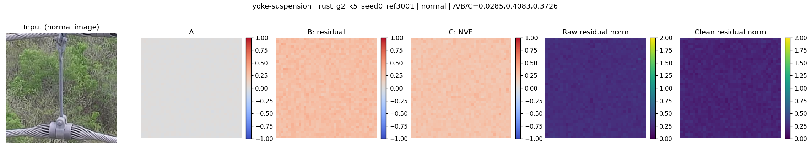

## 执行命令

从工作目录 `/root/auto-exp` 执行；现有结果禁止覆盖，复现需先由人类安排独立输出/归档。

```bash
python3 scripts/start_task.py plan/tasks/M3NVE-residual-v1.yaml
/root/miniconda3/bin/python scripts/m3nve_run.py prepare
# 确认cost_estimate.json full_authorized=true且复现/正确性通过后：
/root/miniconda3/bin/python scripts/m3nve_run.py full
/root/miniconda3/bin/python scripts/m3nve_report.py
python3 scripts/accept_check.py plan/tasks/M3NVE-residual-v1.yaml
```

日志prepare.log/full.log在服务器保留；环境ENVIRONMENT.txt；Git提交及同步状态另见HANDOFF.md。验收不以击败PatchCore为条件。不自动启动IDEAL训练、参数搜索或下一轮任务。
